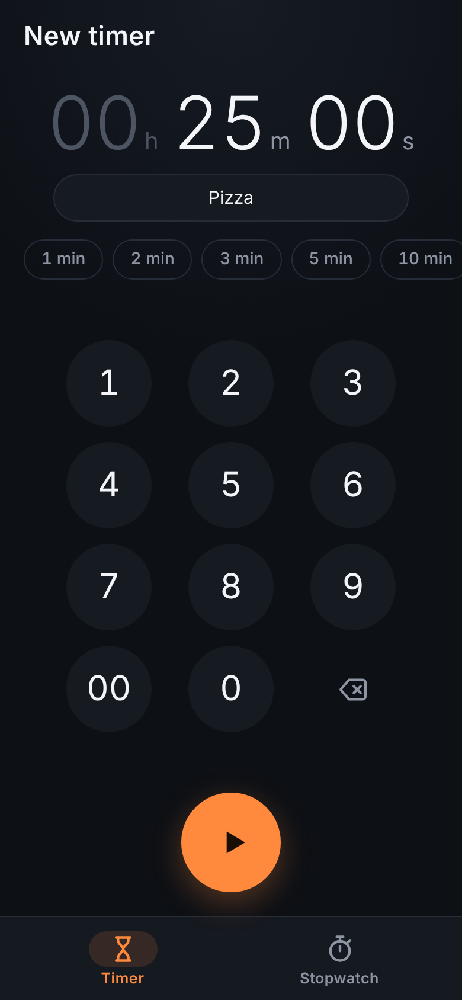
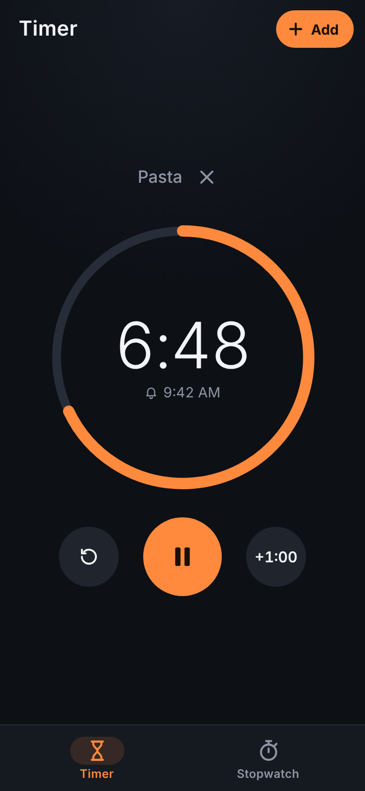
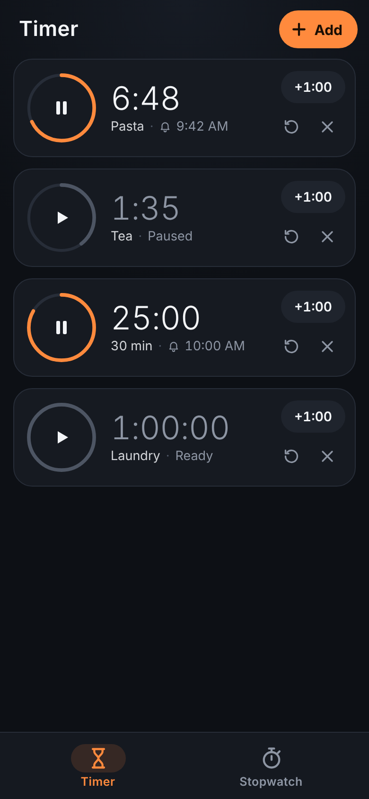
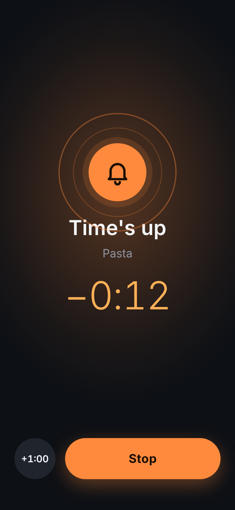
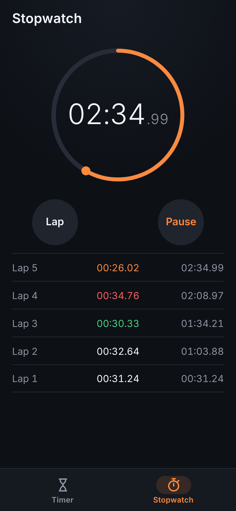

# Timer

A phone-first (portrait) timer and stopwatch.

<p>
  
  
  
  
  
</p>

- **Timers:** type a time on the keypad or tap a preset (1 min to 1 h), add a label if you like, and press start. Digits fill from the right, like a phone clock: 1, 3, 0 is 1 min 30 s. You can run up to 12 timers at once. Each one shows a ring, the time left and the clock time it goes off. You can pause it, add a minute, reset it or delete it.
- **Time's up:** a full-screen alert with your phone's alarm sound and vibration, until you press **Stop** or **+1:00**. The sound stops by itself after 3 minutes, and the alert stays up showing how long ago the timer went off.
- **App closed or screen off (Android app):** every running timer gets an exact system alarm. If the app isn't open when a timer goes off, a notification plays your alarm sound until you open it, press **Stop** or swipe it away. After 10 minutes it gives up. On Android 13 and newer the app asks for permission to show notifications when you start your first timer. If notifications are off, a banner on the Timer tab says so and has an **Allow** button.
- **Stopwatch:** counts hundredths of a second and records laps, with split and total times. The fastest lap is green and the slowest is red.
- Timers and the stopwatch are saved, and they count from clock times, so they stay correct when you close the app or restart the phone.
- Android Back closes the keypad, then goes back to the Timer tab, then leaves the app.

## Android APK

**Download:** [`Timer.apk`](https://raw.githubusercontent.com/kecshow/Apps/main/timer/Timer.apk) (version 1.0, Android 7.0+). Open the link in Chrome on your phone and the download starts. Then open the file to install it. If Android asks, allow "install unknown apps".

`timer/android/` wraps the web app in a small native Android app. A full-screen WebView shows the bundled files, so it works offline. Native code adds what a web page can't do: alarms that ring with the app closed, the alarm sound at alarm volume, and vibration. The page reaches these through `window.TimerBridge`.

```
timer/android/build-apk.sh   # -> timer/android/build/Timer.apk
```

You don't need Android Studio or the Android SDK. The script downloads `aapt2`, the Android API stubs, `dx` and `apksig` from Maven Central into `timer/android/.tools/`. You do need Java 17+, python3, curl and zip. The API stubs jar is old (API 16), so `android/stubs/` declares the few newer APIs the app uses, such as notification channels and exact alarms. Those stubs are only used for compiling and never go into the APK.

The first build creates a signing key at `timer/android/release.p12`, which is not committed. Keep it: an update only installs over an existing install if it is signed with the same key. You can point the script at your own key with `KEYSTORE=... KEYSTORE_PASS=...`.

## In a browser

It's a static web app with no build step and no dependencies. Open `index.html`, or host the `timer/` folder anywhere static and use **Share → Add to Home Screen** on your phone. In a browser, timers only ring while the page is open: they beep through Web Audio and vibrate where the browser supports it.

## Tests

```
node tests/time.test.js
```

This checks the keypad entry, the time formatting, and the timer and stopwatch logic (pause, resume, +1:00, reset, laps).
