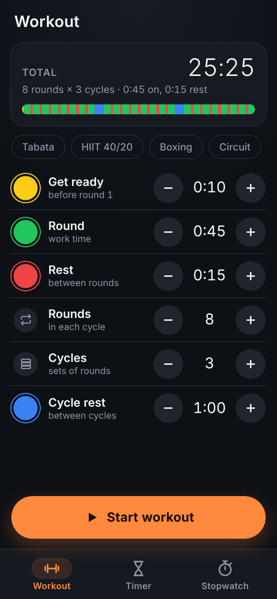
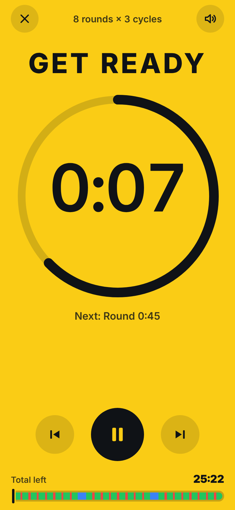
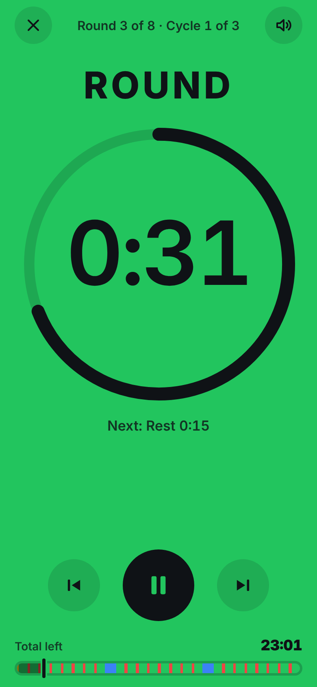
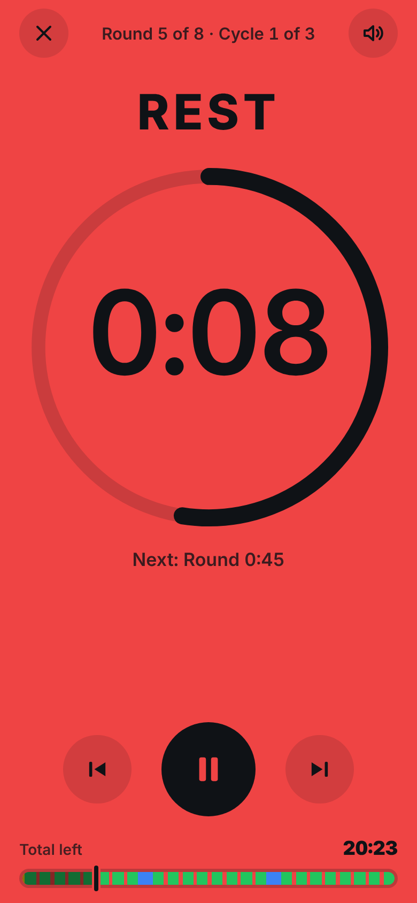
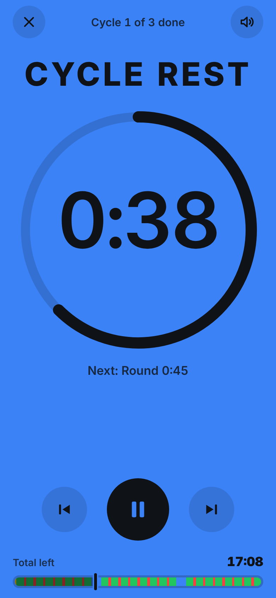

# Timer

A phone-first (portrait) interval training timer, with plain timers and a stopwatch as well.

<p>
  
  
  
  
  
</p>
<p>
  
  
  
  
  
</p>

## Workout

- **Set it up:** round (work) time, rest between rounds, how many rounds in a cycle, how many cycles, and the rest between cycles. There's also a get-ready countdown before the first round. Each one has a − and + button: hold one to change the value quickly. Setting a rest or the get ready to 0:00 turns it off. The total time is shown, along with a bar that draws the whole workout in its colours.
- **Presets:** Tabata (20 s on, 10 s off, 8 rounds), HIIT 40/20 (8 rounds × 3 cycles), Boxing (3 min rounds, 1 min rest, 12 rounds) and Circuit (45/15, 6 rounds × 4 cycles, 2 min between cycles).
- **Colours:** the whole screen takes the colour of the current phase, so you can see from across the room whether you're working or resting. By default get ready is yellow, rounds are green, rest is red and cycle rest is blue. Tap a colour dot to pick another one (12 to choose from). The text switches between black and white to stay readable.
- **While it runs:** big time left in the phase, "Round 3 of 8 · Cycle 2 of 3", what comes next, the total time left, and a bar showing where you are. Pause, skip to the next phase, or go back to the start of the phase (tap again to go to the previous one). The × button asks before it ends the workout.
- **Sounds:** beeps on the last 3 seconds of each phase, a high beep when a round starts, a low one when a rest starts, and a rising one at the end, with vibration. On Android they play at alarm volume, so you hear them over music. The speaker button mutes them.
- **Screen and background:** the screen stays on during a workout. If you leave the app or lock the phone, the workout keeps going. In the Android app, each new round or rest still beeps, as a notification that counts down the phase, and so does the end.

The order: get ready, then each cycle's rounds with a rest between rounds, and the cycle rest between cycles. There's no rest after the last round. If the cycle rest is off, the normal rest is used between cycles.

## Timers and stopwatch

- **Timers:** type a time on the keypad or tap a preset (1 min to 1 h), add a label if you like, and press start. Digits fill from the right, like a phone clock: 1, 3, 0 is 1 min 30 s. You can run up to 12 timers at once. Each one shows a ring, the time left and the clock time it goes off. You can pause it, add a minute, reset it or delete it.
- **Time's up:** a full-screen alert with your phone's alarm sound and vibration, until you press **Stop** or **+1:00**. The sound stops by itself after 3 minutes, and the alert stays up showing how long ago the timer went off.
- **App closed or screen off (Android app):** every running timer gets an exact system alarm. If the app isn't open when a timer goes off, a notification plays your alarm sound until you open it, press **Stop** or swipe it away. After 10 minutes it gives up. On Android 13 and newer the app asks for permission to show notifications when you start your first timer. If notifications are off, a banner on the Timer tab says so and has an **Allow** button.
- **Stopwatch:** counts hundredths of a second and records laps, with split and total times. The fastest lap is green and the slowest is red.
- Timers and the stopwatch are saved, and they count from clock times, so they stay correct when you close the app or restart the phone.
- Android Back closes the keypad or a menu, then goes back to the Workout tab, then leaves the app. A running workout keeps going.

## Android APK

**Download:** [`Timer.apk`](https://raw.githubusercontent.com/kecshow/Apps/main/timer/Timer.apk) (version 1.1, Android 7.0+). Open the link in Chrome on your phone and the download starts. Then open the file to install it. If Android asks, allow "install unknown apps".

`timer/android/` wraps the web app in a small native Android app. A full-screen WebView shows the bundled files, so it works offline. Native code adds what a web page can't do: alarms that ring with the app closed, the alarm sound and workout beeps at alarm volume, vibration, and keeping the screen on. The page reaches these through `window.TimerBridge`.

```
timer/android/build-apk.sh   # -> timer/android/build/Timer.apk
```

You don't need Android Studio or the Android SDK. The script downloads `aapt2`, the Android API stubs, `dx` and `apksig` from Maven Central into `timer/android/.tools/`. You do need Java 17+, python3, curl and zip. The API stubs jar is old (API 16), so `android/stubs/` declares the few newer APIs the app uses, such as notification channels and exact alarms. Those stubs are only used for compiling and never go into the APK.

The first build creates a signing key at `timer/android/release.p12`, which is not committed. Keep it: an update only installs over an existing install if it is signed with the same key. You can point the script at your own key with `KEYSTORE=... KEYSTORE_PASS=...`.

## In a browser

It's a static web app with no build step and no dependencies. Open `index.html`, or host the `timer/` folder anywhere static and use **Share → Add to Home Screen** on your phone. In a browser, timers and workouts only make sounds while the page is open: they beep through Web Audio, and vibrate and keep the screen on where the browser supports it.

## Tests

```
node tests/time.test.js
```

This checks the keypad entry, the time formatting, the timer and stopwatch logic (pause, resume, +1:00, reset, laps), and workouts: the order of rounds, rests and cycles, totals, skip and back, and the − and + steps.
